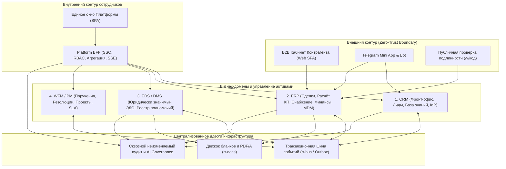

# Стратегия экосистемы RailTech Platform и профиль международной сертификации
Статус: действует · Владелец: владелец · Обновлено: 2026-11-07

Настоящий документ определяет целевую стратегию цифровой экосистемы **RailTech Platform**, ценность и границы каждого из её функциональных контуров, а также нормативно-технический профиль соответствия международным и национальным стандартам для прохождения сертификации по **кибербезопасности** (Платформа сотрудников + B2B-Кабинет контрагента) и **менеджменту качества**.

Связанные документы: [`2026-10-23-platform-architecture-strategy.md`](2026-10-23-platform-architecture-strategy.md), [`2026-11-01-plan-refresh.md`](2026-11-01-plan-refresh.md), [`../product/SPEC-v3.md`](../product/SPEC-v3.md), [`../product/BUSINESS.md`](../product/BUSINESS.md), [`../product/COUNTERPARTY-CABINET.md`](../product/COUNTERPARTY-CABINET.md), [`../adr/0024-signing-authority-and-official-documents.md`](../adr/0024-signing-authority-and-official-documents.md).

---

## 1. Архитектурная концепция экосистемы

**RailTech Platform** — это интегрированная корпоративная B2B-экосистема промышленного класса с защищённым порталом самообслуживания контрагентов (клиентов, поставщиков и заводов-изготовителей). Экосистема построена на принципах **Domain-Driven Design (DDD)**, **Zero-Trust Security** и **Quality by Design**:

1. **Чёткое разделение ответственности доменов**: каждая система решает строго свою бизнес-задачу и владеет своими данными; прямые обращения к чужим базам данных запрещены архитектурно.
2. **Двухконтурная изоляция безопасности**: внутренний контур сотрудников (**Платформа**, `apps/platform`) и внешний контур самообслуживания контрагентов (**Кабинет**, `apps/cabinet`) физически и логически разделены по механизмам аутентификации, пулам сессий, токенам и сетевым маршрутам.
3. **Контрактное взаимодействие и гарантированная шина**: синхронные вызовы выполняются по строгим спецификациям `OpenAPI 3.1`, а междоменные события доставляются через транзакционную шину **`rt-bus`** (`AsyncAPI`, паттерн *Transactional Outbox* поверх PostgreSQL и Redis Streams) с гарантией доставки *at-least-once* и идемпотентными приёмниками.
4. **Юридическая чистота и неизменяемость документов**: любой официальный документ компании проходит проверку полномочий подписанта в реестре ЭДО (`SigningAuthority`), получает уникальный криптографический код проверки (`/v/<код>`) и фиксируется в формате PDF/A с контрольной суммой `SHA-256`.

---

## 2. Функциональные контуры экосистемы

### 2.1. CRM (Customer Relationship Management) — Интеллектуальный Фронт-Офис
**Ключевой вопрос домена:** *«Кто к нам обратился, в чём его потребность и как быстро конвертировать обращение в квалифицированный запрос?»*

**Ценность в Экосистеме:**
- **Управление отношениями и омниканальное привлечение (24/7, RU/UZ/EN)**: приём и обработка обращений из Telegram-бота, веб-форм и корпоративной почты со временем первого ответа до 1 минуты за счёт ИИ-консультанта, опирающегося исключительно на проверенную Базу знаний.
- **Генерация лидов, снижение оттока и возврат клиентов (Lead Qualification, Retention & Win-Back)**: автоматическая идентификация потенциальных заказчиков, прозрачный скоринг зрелости лида, раннее выявление спада активности и реактивация спящих клиентов.
- **Рост конверсии и прозрачность каналов продаж**: 100 % истории взаимодействия принадлежит компании (а не личным мессенджерам сотрудников); передача квалифицированного клиента в ERP выполняется одной кнопкой с полным сохранением контекста потребности.

**Основные Функции:**
- Ведение единого профиля лидов, потенциальных клиентов и истории омниканальных диалогов.
- ИИ-квалификация потребностей, автоматическое резюмирование диалогов и бесшовное подключение живого менеджера.
- Управление корпоративной Базой знаний с автоматической фиксацией информационных пробелов по вопросам клиентов.
- Ведение справочника сотрудников, организационной структуры, ролей и периодов замещения (`deputy`) как единого источника правды (IdP) для всей Платформы.

---

### 2.2. ERP (Enterprise Resource Planning) — Коммерческое и Операционное Ядро
**Ключевой вопрос домена:** *«Как рассчитать экономику, согласовать условия, обеспечить закупку и довести запрос клиента до закрытой и оплаченной сделки?»*

**Ценность в Экосистеме:**
- **Оптимизация управления ресурсами и маржинальностью**: сквозной контроль экономики сделки — от прайс-листов поставщиков и заводов, таможенных пошлин (ТН ВЭД), логистических затрат и валютных курсов до расчёта целевой маржи коммерческого предложения.
- **Унификация мастер-данных (MDM)**: централизованное ведение эталонных справочников контрагентов (резидентов и нерезидентов), номенклатурного каталога, технических документов, сертификатов соответствия, стран (ISO 3166-1) и валют (ISO 4217).
- **Автоматизация сквозного цикла сделки (Order-to-Cash & Procure-to-Pay)**: полная автоматизация переходов `Запрос → Расчёт → КП → Договор → Счёт → Оплата → Поставка (Fulfillment) → Акт приёмки → Гарантия` с минимизацией ручного ввода и расчётных ошибок.

**Основные Функции:**
- Управление финансовыми данными сделки: выставление счетов, учёт входящих и исходящих платежей, контроль дебиторской задолженности и мультивалютные пересчёты.
- Управление закупками и взаимоотношениями с поставщиками (SRM / Sourcing): онбординг кандидатов в партнёры, согласование партнёрских договоров, импорт и модерация прайс-листов, выпуск заказов поставщикам (PO).
- Управление поставками и исполнением обязательств: контроль отгрузок, партий, статусов доставки и попозиционной приёмки товара клиентом.
- Управление опубликованным промышленным каталогом с гибкими правилами видимости цен и технической документации.

---

### 2.3. EDS / DMS (Electronic Document & Signing Management System) — Юридически Значимый Документооборот
**Ключевой вопрос домена:** *«Имеет ли документ официальную юридическую силу, кто уполномочен его подписать и как гарантировать его подлинность и неизменность?»*

**Ценность в Экосистеме:**
- **Единый регламент официальной подписи ([ADR-0024](../adr/0024-signing-authority-and-official-documents.md))**: ни один официальный документ компании (исходящее письмо, КП, договор, счёт, акт) не выпускается со свободной текстовой подписью. До момента подписания уполномоченным лицом любой PDF формируется исключительно с защитным водяным знаком «ПРОЕКТ» без регистрационного номера.
- **Цифровой реестр полномочий (`SigningAuthority`)**: автоматическая проверка права сотрудника подписывать конкретный вид документа с учётом лимита суммы сделки, валюты и срока действия основания (Устав, Приказ, Доверенность со ссылкой на Vakolat.uz и контролем 3-летнего предела по ст. 139 ГК РУз).
- **Неизменяемость и публичная верификация подлинности**: при подписании документ получает официальный регистрационный номер, рендерится в архивный формат PDF/A с отпечатком `SHA-256`, снабжается QR-кодом и становится проверяемым через публичный сервис `/v/<код>`.

**Основные Функции:**
- Регистрация входящей и исходящей корреспонденции, автоматическая нумерация по журналам регистрации.
- Централизованный конструктор корпоративных бланков и печатного рендеринга PDF/A и DOCX (`rt-docs`).
- Маршрутизация согласования документов, единый шаг «Подписать» для всех доменов экосистемы и архитектурная готовность к аппаратной/облачной ЭЦП (**E-IMZO / PKCS#7**).
- Версионирование (исправление подписанного документа только через выпуск новой ревизии со ссылкой на прежнюю), архивное хранение и полнотекстовый поиск.

---

### 2.4. WFM / PM (Workflow, Task & Project Management System) — Управление Поручениями, Проектами и SLA
**Ключевой вопрос домена:** *«Кто отвечает за конкретный рабочий шаг, к какому сроку он должен быть выполнен и как исключить зависание процессов?»*

*(Примечание: в международной железнодорожной и логистической практике аббревиатура TMS закреплена за Transportation Management System, поэтому для контура задач, поручений и проектов в стандартах качества используется обозначение **WFM / PM — Workflow, Task & Project Management**).*

**Ценность в Экосистеме:**
- **Сквозное управление поручениями и резолюциями**: каждое входящее письмо, клиентский запрос, заявка поставщика или карточка товара автоматически порождает отслеживаемую рабочую задачу с назначенным исполнителем и сроком (SLA).
- **Контроль прогресса и предотвращение узких мест**: визуальный контроль очередей («Ждут действия», «На согласовании», «На проверке снабжения»), автоматическое закрытие поручений при выполнении целевого действия (например, при отправке ответного письма или выпуске КП).
- **Непрерывность процессов при замещении**: учёт отпусков и командировок через проекцию замещений из CRM — задачи автоматически переводятся на заместителя, при этом право официальной подписи проверяется строго по собственным полномочиям заместителя в реестре.

**Основные Функции:**
- Управление проектными досье (связка сделок, договоров, писем, спецификаций и платежей в единый проект).
- Управление рабочими очередями и поручениями руководителей по шаблонам резолюций.
- Мониторинг SLA, упреждающие напоминания об истечении сроков и эскалация просрочек.
- Распределение ресурсной нагрузки между специалистами фронт-офиса, снабжения, коммерческого отдела и делопроизводства.

---

### 2.5. B2B Кабинет Контрагента (`Cabinet`) — Защищённый Контур Самообслуживания
**Ключевой вопрос домена:** *«Как клиенту, поставщику и заводу-изготовителю взаимодействовать с компанией прозрачно, быстро и безопасно?»*

**Ценность в Экосистеме:**
- **Цифровое самообслуживание 24/7 (Web SPA + Telegram Mini App)**: контрагент видит все свои запросы, КП, договоры, счета, оплаты, поставки и акты в одном окне на трёх языках (`ru` / `uz` / `en`), а из уведомлений в Telegram переходит по прямому deep-link сразу в нужный документ.
- **Единый профиль компании с мультиролевой моделью (`client` + `partner`)**: одна организация может одновременно выступать покупателем и поставщиком/производителем без дублирования карточек компании; доступные разделы кабинета определяются подключёнными модулями.
- **Юридическая значимость действий контрагента**: согласование проектов договоров, акцепт КП, приёмка поставок и подтверждение критических операций защищены одноразовыми кодами (OTP), ключами идемпотентности и неизменяемым журналом доказательств.

**Основные Функции:**
- Клиентский контур: создание запросов, сравнение и акцепт КП, согласование и подписание договоров, загрузка платёжных подтверждений, отслеживание поставок и подписание актов.
- Партнёрский контур: подача заявки «Стать партнёром», согласование партнёрского договора, ведение карточек продукции, пакетная загрузка прайс-листов и технической документации.
- Контекстный чат с персональным менеджером или отделом снабжения с привязкой к конкретному документу или сделке.
- Управление командой компании-контрагента, ролями сотрудников, активными сессиями и матрицей уведомлений.

---

### 2.6. Централизованное Ядро Экосистемы (`Platform Core`, `rt-bus`, IAM & Security Governance)
**Ключевой вопрос домена:** *«Как объединить все бизнес-домены в единую отказоустойчивую систему с общим управлением активами, правами и безопасностью?»*

**Ценность в Экосистеме:**
- **Единое рабочее окно сотрудника (`apps/platform`)**: все внутренние роли работают в едином интерфейсе Платформы с общим глобальным поиском, сквозной лентой событий в реальном времени (SSE) и контекстными боковыми панелями без переключения между системами.
- **Унификация интеграций и отсутствие потери данных**: централизованная шина событий `rt-bus` и строгие машиночитаемые контракты (`packages/contracts/`) исключают рассинхронизацию данных между CRM, ERP и EDS.
- **Централизованное управление доступом и качеством**: единая ролевая матрица RBAC (`platform-rbac.yaml`), сквозная трассировка запросов (`X-Request-ID`), централизованный аудит безопасности и контроль использования ИИ-моделей.

**Основные Функции:**
- Backend-for-Frontend (BFF) шлюз: аутентификация сотрудников (SSO + обязательная 2FA TOTP для привилегированных ролей), проверка прав доступа на уровне маршрутов и полей.
- Транзакционная шина событий `rt-bus`: гарантированная доставка междоменных событий, консоль мониторинга очередей и управление перезапуском сбойных сообщений (DLQ).
- Сквозной журнал аудита безопасности (`Audit Log`): неизменяемая фиксация всех входов, изменений ролей, выдачи полномочий подписи, выгрузки документов и критических операций.
- Контур управления качеством справочников, единой дизайн-системой (`packages/ui-tokens`) и встроенной многоязычной справкой (`docs/kb/help/`).

---

## 3. Профиль соответствия мировым стандартам и сертификации

После завершения разработки экосистема (Платформа сотрудников + B2B-Кабинет контрагента) подаётся на получение сертификатов **кибербезопасности** и **менеджмента качества**. Ниже приведена матрица стандартов, заложенных в архитектуру проекта.

### 3.1. Сертификация кибербезопасности и защиты информации (Платформа + Кабинет)

| Стандарт / Регулятор | Область сертификации | Архитектурные и технические меры в RailTech Platform |
|---|---|---|
| **ISO/IEC 27001:2022** & **ISO/IEC 27002:2022** | Система менеджмента информационной безопасности (ISMS) | • Строгое разделение контуров разработки, тестирования и промышленной эксплуатации. • Управление доступом по принципу наименьших привилегий (*Least Privilege*, настраиваемый RBAC в Платформе и модульный доступ `HasPortalModule` в Кабинете). • Полный журнал событий безопасности без возможности удаления записей. • Автоматизированное резервное копирование БД и хранилища с шифрованием и проверкой восстановления. |
| **OWASP ASVS v4.0 (Level 2 / Level 3)** & **OWASP Top 10** | Безопасность веб-приложений и API (Platform BFF, ERP Portal API, Cabinet SPA) | • Полная изоляция аутентификации сотрудников (JWT/SSO + 2FA TOTP) и внешних контрагентов (сессионные `HttpOnly`, `Secure`, `SameSite` cookie с хранением в БД только `SHA-256` хеша токена). • Защита всех мутирующих запросов (`POST`/`PUT`/`PATCH`) в Кабинете обязательным заголовком `Idempotency-Key` и строгой проверкой `Content-Type: application/json` (защита от CSRF и повторной отправки). • Строгая валидация схем входных данных (Pydantic v2 / DRF Serializers / Zod), защита от SQL-инъекций (ORM / параметризованные запросы) и XSS (React auto-escaping + CSP). • Многоуровневый Rate Limiting (по сессии, по e-mail адресу, по IP) на вход, запрос кодов и API. |
| **ГУП «Центр кибербезопасности» (CSEC / UzCERT, РУз)** & **O'z DSt ISO/IEC 27001** | Национальная аттестация и сертификация кибербезопасности в Республике Узбекистан | • Соответствие требованиям экспертизы исходного кода (отсутствие зашитых секретов — контроль `gitleaks`, аудит уязвимостей сторонних пакетов `pip-audit` и `pnpm audit` в CI). • Защита от несанкционированного доступа, перебора одноразовых кодов и подмены документов. • Готовность к динамическому тестированию на проникновение (Pentest / DAST) на изолированном предпродакшн-стенде. |
| **SOC 2 Type II** *(Trust Services Criteria)* | Безопасность, доступность, целостность обработки, конфиденциальность | • Паттерн *Transactional Outbox* (`rt-bus`) и идемпотентные обработчики гарантируют целостность обработки транзакций между сервисами. • Health-проверки всех узлов, мониторинг фоновых очередей и контролируемый регламент выкладки с автоматическим откатом. |
| **ЗРУ-547 «О персональных данных»** & **ISO/IEC 27701** | Защита и локализация персональных данных | • Размещение баз данных и объектного хранилища на территории Республики Узбекистан (либо в сертифицированном контуре по требованиям регулятора). • Явный сбор согласия на обработку ПДн (`consent`) при подаче заявок в Кабинете. • Запрет записи персональных адресов, телефонов и сырых токенов в технические логи при ошибках аутентификации. |

---

### 3.2. Сертификация качества, документооборота и отраслевых стандартов

| Стандарт | Область соответствия | Реализация в экосистеме RailTech Platform |
|---|---|---|
| **ISO 9001:2015** *(Quality Management Systems)* | Система менеджмента качества бизнес-процессов | • Стандартизованный и воспроизводимый сквозной процесс от обращения клиента до закрывающего акта. • Измеримые показатели качества (SLA времени ответа, полнота комплекта документов, причины отклонения КП и возврата актов). • Встроенный контур обратной связи, претензионной работы и корректирующих действий. |
| **ISO/TS 22163 (IRIS)** *(International Railway Industry Standard)* | Мировой стандарт качества для железнодорожной промышленности | • Прослеживаемость продукции в каталоге и сделках: привязка к заводу-изготовителю, стране происхождения, артикулу производителя (MPN), гарантийному сроку и техническим сертификатам. • Обязательная модерация карточек товаров и прайс-листов службой снабжения перед публикацией клиентам (`ReviewQueue`). • Контроль сроков действия сертификатов соответствия и происхождения. |
| **ISO 15489-1** & **ISO 19005 (PDF/A)** & **ЗРУ-793 / ЗРУ-611-II** | Управление официальными документами, архивное хранение и ЭЦП | • Строгий жизненный цикл документа: черновик («ПРОЕКТ») → проверка полномочий (`SigningAuthority`) → подписание → неизменяемый PDF/A с `SHA-256` и QR-кодом `/v/<код>`. • Невозможность задним числом изменить подписанный документ. • Полная совместимость с национальным законодательством РУз об электронном документообороте и ЭЦП (E-IMZO). |
| **ISO 8000** & **DAMA-DMBOK** | Качество корпоративных мастер-данных (MDM) | • Единые классификаторы стран (ISO 3166-1 с масками телефонов и налоговых номеров ИНН/БИН/Tax ID), валют (ISO 4217), единиц измерения и кодов ТН ВЭД. • Автоматическая дедупликация контрагентов по паре `(страна, налоговый номер)`. |
| **WCAG 2.1 Level AA** *(ISO/IEC 40500)* | Доступность и эргономика пользовательских интерфейсов | • Автоматизированный контроль доступности интерфейсов Платформы и Кабинета в CI (`@axe-core/playwright`), контрастность по токенам дизайн-системы, полноценная навигация с клавиатуры и поддержка трёх языков (`ru`, `uz`, `en`). |

---

## 4. Чек-лист предсертификационной готовности (Платформа + Кабинет)

Перед подачей официальной заявки в сертификационный орган (ГУП «Центр кибербезопасности» / международный аудитор ISO 27001 и ISO 9001) система проходит внутренний гейт по пяти блокам:

1. **Изоляция данных (Multi-Tenant & Role Boundary)**:
   - 100 % эндпоинтов Кабинета (`/api/portal/v1/*`) покрыты автоматическими негативными тестами на изоляцию компании сессии (запрос чужого объекта всегда возвращает `404 NOT_FOUND`) и изоляцию модулей роли (`403 MODULE_REQUIRED`).
2. **Криптографическая гигиена и управление секретами**:
   - Все токены входа, приглашений и сессий хранятся исключительно в виде криптографических хешей `SHA-256`; сырые значения передаются только в защищённом канале; `gitleaks` подтверждает отсутствие секретов во всей истории Git.
3. **Юридическая прослеживаемость документов**:
   - Все виды внешних документов (`letter_out`, `quote`, `contract`, `invoice`, `act`) проходят через реестр полномочий `SigningAuthority`, содержат проверочный QR-код `/v/<код>` и валидируются по контрольной сумме `SHA-256`.
4. **Непрерывность и отказоустойчивость**:
   - Настроены и проверены регулярные зашифрованные бэкапы баз данных и файлового хранилища на внешний независимый контур с документально подтверждённым тестом восстановления (*Disaster Recovery Drill*).
5. **Комплект эксплуатационной и нормативной документации**:
   - Актуализированы архитектурные контракты (`OpenAPI`, `AsyncAPI`), матрица ролей и прав (`platform-rbac.yaml`), регламенты реагирования на инциденты (`docs/runbooks/`) и пользовательские инструкции (`docs/kb/help/`).

---

## 5. Заключение

Экосистема **RailTech Platform**, объединяющая **CRM**, **ERP**, **EDS (DMS)**, **WFM/PM**, **B2B-Кабинет Контрагента (`Cabinet`)** и **Централизованное Ядро Платформы (`Platform Core + rt-bus`)**, обеспечивает замкнутый, прозрачный и юридически защищённый цикл управления всеми бизнес-активами компании. Заложенные архитектурные инварианты — изоляция контуров, строгие машиночитаемые контракты, криптографическая верификация документов и сквозной аудит — создают прочный фундамент для успешного получения сертификатов кибербезопасности и международного соответствия стандартам качества.
