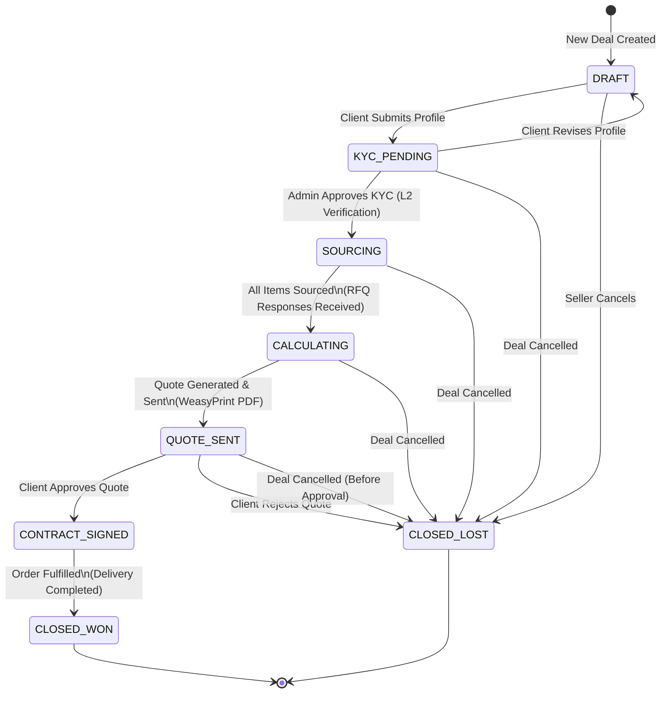
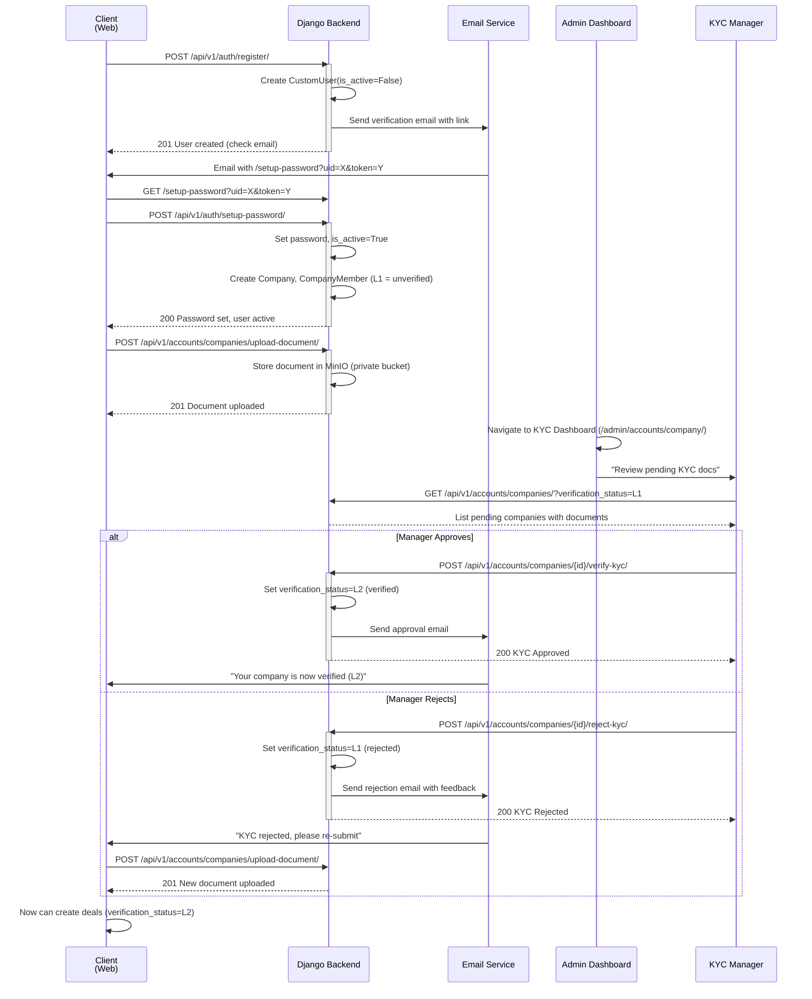
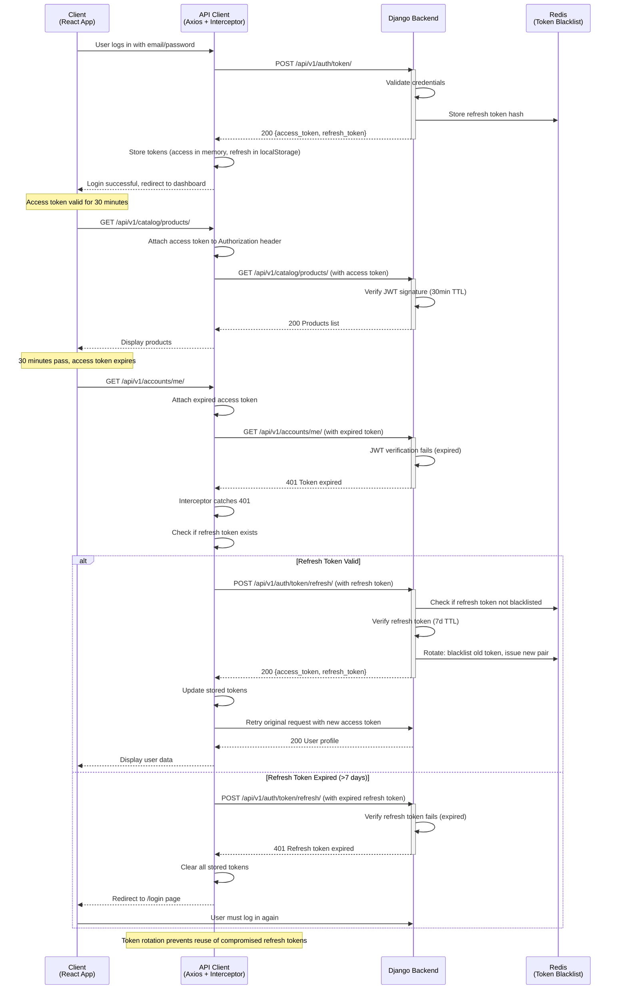
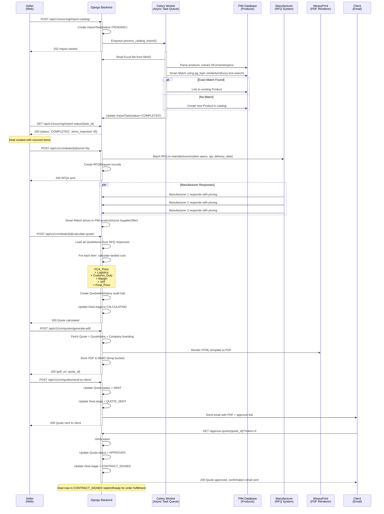
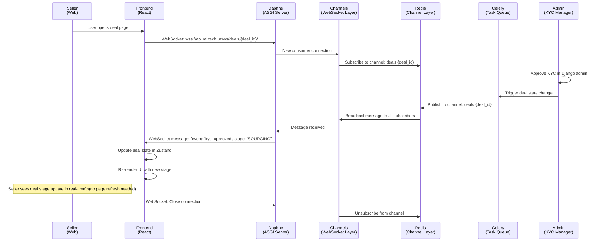
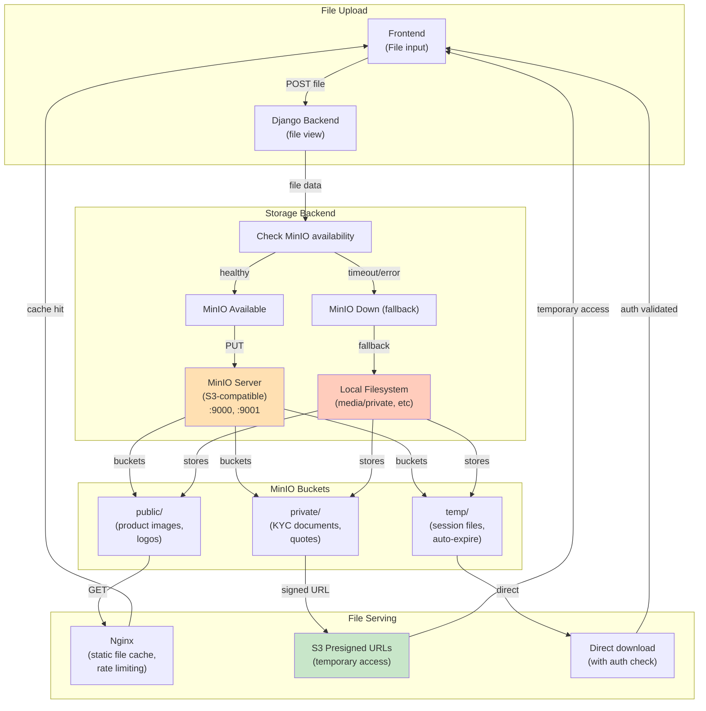
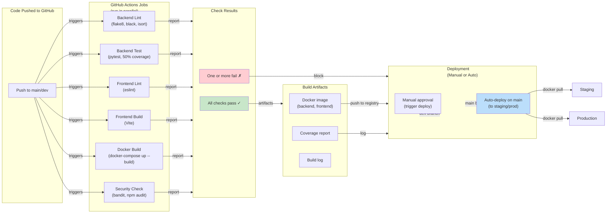
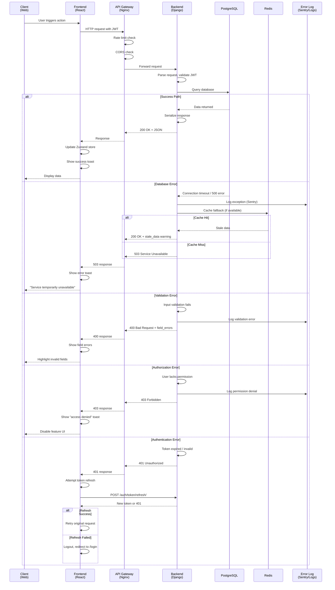

# RailTech B2B SaaS — Architecture Diagrams

**Last Updated:** 2026-04-17

Mermaid-диаграммы ключевых потоков и архитектуры RailTech. Источник правды по моделям — [technical-specification.md](technical-specification.md); по стадиям сделки — [business-logic.md](business-logic.md).

> **Примечание:** На схеме мульти-тенантности блок `RFQRequest` — концептуальный (часть Sprint 4). В текущей реализации RFQ моделируется через `Deal` + `QuoteItem` (см. [business-logic.md](business-logic.md) §2.3).

---

## 1. Deal FSM (State Diagram)

The deal lifecycle follows a finite state machine with clear transitions:



**Stage Details:**
- **DRAFT**: Deal created, waiting for company profile completion
- **KYC_PENDING**: Company profile submitted, awaiting admin L2 verification
- **SOURCING**: KYC approved, sourcing RFQs sent to manufacturers
- **CALCULATING**: Items quoted by manufacturers, quote being calculated
- **QUOTE_SENT**: Final quote generated and sent to client for approval
- **CONTRACT_SIGNED**: Client approved quote, deal moving to fulfillment
- **CLOSED_WON**: Order delivered, deal won
- **CLOSED_LOST**: Deal cancelled or client rejected quote

---

## 2. KYC Verification Flow (Sequence Diagram)

The Know-Your-Customer (KYC) process includes document verification and two-level status tracking:



**Key Points:**
- **L1 Status**: User registered, password set, company created but unverified
- **L2 Status**: Documents approved by KYC manager, full access enabled
- Documents stored in MinIO private bucket with access control
- Email verification happens at registration and KYC milestone stages

---

## 3. Authentication Flow (Sequence Diagram)

JWT-based authentication with automatic token refresh:



**Key Points:**
- Access token TTL: 30 minutes
- Refresh token TTL: 7 days
- Token rotation on refresh to prevent replay attacks
- Refresh tokens stored in Redis with blacklist on rotation
- Axios interceptor handles 401 responses automatically

---

## 4. Sourcing & Quote Generation Flow (Sequence Diagram)

Complete workflow from Excel import through quote delivery:



**Key Workflow Steps:**

1. **Excel Import (Celery Task):**
   - Parse product data from Excel
   - Smart Match to PIM using PostgreSQL `pg_trgm` similarity search
   - Create new products or link to existing ones

2. **RFQ & Pricing:**
   - Send RFQ to manufacturers with specifications
   - Collect responses with unit prices
   - Record in SupplierOffer

3. **Quote Calculation:**
   - Load landed cost formula per item:
     - Base price (from manufacturer)
     - Shipping/logistics cost
     - Customs duty
     - Seller margin (configurable)
     - VAT calculation
   - Store all calculations in QuoteItemHistory for audit trail
   - Create financial snapshot (decimal.js precision)

4. **PDF Generation:**
   - Render quote template with company logo
   - Convert to PDF via WeasyPrint
   - Store in MinIO (temp bucket, auto-expire)

5. **Client Approval:**
   - Send secure link to client
   - Client approves/rejects
   - Deal transitions to CONTRACT_SIGNED or CLOSED_LOST

---

## 5. Multi-Tenancy & Company Role Architecture

How the platform handles multiple company types and roles:

```mermaid
graph TB
    subgraph Users["Users & Authentication"]
        CustomUser["CustomUser<br/>(email login)"]
        SystemRole["SystemRole<br/>(ADMIN, MANAGER, CLIENT)"]
    end

    subgraph Company["Company & Multi-Tenancy"]
        Company["Company<br/>(name, type, kyc_status)"]
        CompanyType["CompanyType<br/>(CLIENT, SUPPLIER, MANUFACTURER)"]
        CompanyMember["CompanyMember<br/>(user, company, role)"]
    end

    subgraph CatalogDomain["Catalog & Products (PIM)"]
        Product["Product<br/>(sku, name, specs)"]
        Category["Category<br/>(hierarchy)"]
        SupplierOffer["SupplierOffer<br/>(supplier, product, price)"]
        EquipmentGroup["EquipmentGroup<br/>(standard groups)"]
    end

    subgraph CRMDomain["CRM & Deal Management"]
        Deal["Deal<br/>(status, company_id, stage)"]
        Quote["Quote<br/>(deal_id, total_price, status)"]
        QuoteItem["QuoteItem<br/>(quote_id, product_id, qty, price)"]
        QuoteItemHistory["QuoteItemHistory<br/>(audit trail)"]
        Message["Message<br/>(deal comments)"]
    end

    subgraph SourcingDomain["Sourcing & Imports"]
        ImportTask["ImportTask<br/>(status, file_url)"]
        RFQRequest["RFQRequest<br/>(manufacturer, items)"]
        Attachment["Attachment<br/>(documents)"]
    end

    subgraph MasterData["Master Data & Reference"]
        Country["Country<br/>(code, name)"]
        Currency["Currency<br/>(code, symbol)"]
        UOM["Unit of Measure<br/>(kg, pcs, m, etc)"]
        DeliveryBasis["Delivery Basis<br/>(FCA, CIF, DDP)"]
    end

    CustomUser -->|has| CompanyMember
    CompanyMember -->|belongs to| Company
    Company -->|has types| CompanyType
    CustomUser -->|has role| SystemRole

    Company -->|SUPPLIER| SupplierOffer
    SupplierOffer -->|references| Product

    Deal -->|created by| Company
    Deal -->|has| Quote
    Quote -->|contains| QuoteItem
    QuoteItem -->|references| Product
    QuoteItem -->|tracked by| QuoteItemHistory

    Deal -->|has| Message
    Deal -->|has| RFQRequest
    RFQRequest -->|sent to| Company

    ImportTask -->|imports to| Product
    Attachment -->|supports| Deal

    Product -->|in| Category
    Product -->|in| EquipmentGroup
    Product -->|measured in| UOM
    Deal -->|priced in| Currency
    SupplierOffer -->|from| Country
    Quote -->|delivery via| DeliveryBasis

    style CustomUser fill:#e1f5ff
    style Company fill:#f3e5f5
    style CompanyMember fill:#f3e5f5
    style Deal fill:#e8f5e9
    style Quote fill:#e8f5e9
    style Product fill:#fff3e0
    style SupplierOffer fill:#fff3e0
```

**Multi-Tenancy Model:**
- No schema/database isolation (single-tenant architecture)
- Tenancy via `CompanyMember` join table with `company_id` filtering
- Every API query includes company context from JWT (via `request.user.company`)
- Company types determine UI layout and feature access (BUYER, SELLER, MANUFACTURER)

---

## 6. Frontend State Management & Role-Based Access

How the React frontend manages auth state and role context:

```mermaid
graph TB
    subgraph Browser["Browser (React App)"]
        LoginPage["LoginPage<br/>(email/password entry)"]
        PasswordSetupPage["PasswordSetupPage<br/>(setup-password route)"]
        KYCRegistrationForm["KYCRegistrationForm<br/>(profile + documents)"]
        DashboardPage["DashboardPage<br/>(main SPA)"]
    end

    subgraph Zustand["Zustand Stores<br/>(Client-side State)"]
        AuthStore["authStore<br/>(user, tokens, loggedIn)"]
        UserStore["userStore<br/>(firstName, activeStatus,<br/>kycStatus, companyId)"]
        ThemeStore["themeStore<br/>(dark mode)"]
        CurrencyStore["currencyStore<br/>(selected currency)"]
        DomainStore["domainStore<br/>(Uzbek domain state)"]
    end

    subgraph APIClient["API Client (Axios)"]
        APIInterceptor["JWT Interceptor<br/>(attach token, refresh on 401)"]
        CatalogAPI["catalogApi<br/>(products, offers)"]
        CRMAPI["crmApi<br/>(deals, quotes)"]
        AccountsAPI["accountsApi<br/>(users, companies)"]
    end

    subgraph Layouts["Shell Layouts<br/>(shadcn Sidebar)"]
        AppShell["AppShell<br/>(Buyer/Seller context<br/>hash-based SPA)"]
        AdminShell["AdminShell<br/>(/admin/*, React Router)"]
        ClientShell["ClientShell<br/>(/cabinet/*, React Router)"]
        CatalogShell["CatalogShell<br/>(Public catalog,<br/>no sidebar)"]
    end

    subgraph RoleMapping["Frontend Role Mapping<br/>(from userStore.loadFromAuth)"]
        L1Unverified["L1 (Unverified)<br/>Only profile page"]
        L2Verified["L2 (Verified)<br/>Create deals"]
        BuyerStatus["BUYER Status<br/>(CLIENT company type)<br/>See sourcing dashboard"]
        SellerStatus["SELLER Status<br/>(SUPPLIER company type)<br/>See catalog mgmt + RFQ"]
        ManufacturerStatus["MANUFACTURER Status<br/>(MANUFACTURER type)<br/>Respond to RFQs"]
    end

    LoginPage -->|POST /auth/token/| APIClient
    LoginPage -->|success| AuthStore
    AuthStore -->|tokens stored| Browser

    PasswordSetupPage -->|POST /auth/setup-password/| APIClient
    KYCRegistrationForm -->|POST /auth/submit-profile/| APIClient
    KYCRegistrationForm -->|POST /accounts/companies/upload-document/| APIClient

    AuthStore -->|user data| UserStore
    APIClient -->|GET /accounts/me/| UserStore
    UserStore -->|loadFromAuth()| UserStore
    UserStore -->|maps CompanyType| RoleMapping

    UserStore -->|activeStatus| AppShell
    UserStore -->|activeStatus| AdminShell
    UserStore -->|activeStatus| ClientShell
    UserStore -->|kycStatus| RoleMapping

    RoleMapping -->|L1| AppShell
    RoleMapping -->|L2 + BUYER| DashboardPage
    RoleMapping -->|L2 + SELLER| DashboardPage

    AuthStore -->|access token| APIInterceptor
    APIInterceptor -->|calls| CatalogAPI
    APIInterceptor -->|calls| CRMAPI
    APIInterceptor -->|calls| AccountsAPI

    CatalogAPI -->|products| DashboardPage
    CRMAPI -->|deals, quotes| DashboardPage
    AccountsAPI -->|user, company| DashboardPage

    ThemeStore -->|CSS variables| AppShell
    CurrencyStore -->|decimal.js| DashboardPage
    DomainStore -->|UZ state| DashboardPage

    style AuthStore fill:#e3f2fd
    style UserStore fill:#e3f2fd
    style AppShell fill:#f1f8e9
    style RoleMapping fill:#fff9c4
```

**Frontend Authentication Flow:**

1. **Login**: `LoginPage` → POST `/auth/token/` → get access + refresh tokens
2. **Token Storage**: Access in memory (secure), refresh in localStorage (persistent)
3. **Load User**: `userStore.loadFromAuth()` → GET `/accounts/me/` → maps CompanyType to frontend CompanyStatus
4. **Role Determination**: `userStore.activeStatus` + `kycStatus` determines UI layout and feature access
5. **Token Refresh**: Axios interceptor catches 401, auto-refreshes via POST `/auth/token/refresh/`, retries request
6. **Logout**: Clear tokens, `AuthStore` → `loggedIn=false`, redirect to `/login`

**Store Persistence:**
- `authStore` and `themeStore` use `persist` middleware (localStorage)
- Other stores are ephemeral (cleared on reload)

---

## 7. WebSocket & Real-Time Communication (Channels)

How the backend handles real-time deal updates:



**WebSocket Setup:**
- Daphne (ASGI) replaces Gunicorn for WebSocket support
- Redis as channel layer (separate from Celery Redis on :6380)
- Consumer logic in `core/consumers.py`
- Broadcast on deal updates (stage change, quote approval, etc.)

---

## 8. Storage Architecture (MinIO & Local Fallback)

File storage and serving strategy:



**Bucket Strategy:**
- **public/**: Product images, company logos (cached by Nginx, no auth)
- **private/**: KYC documents, quotes, contracts (presigned URLs with 1h expiry)
- **temp/**: Session uploads, temporary files (auto-delete after 7 days)

**Fallback:**
- If MinIO unavailable → write to local filesystem (`/app/media/`)
- Avoids request blocking on storage failure

---

## 9. CI/CD Pipeline (GitHub Actions)

Automated testing, linting, and deployment:



**Pipeline Summary:**
- 6 parallel jobs (linting, testing, building)
- Blocks deployment on failure
- Artifacts: Docker images, coverage reports, build logs
- Auto-deploy on `main`, manual approval on `dev`

---

## 10. Error Handling & Observability

Request lifecycle with error handling:



**Error Handling Layers:**

1. **Frontend (React):**
   - Axios interceptor catches HTTP errors
   - Toast notifications for user-facing errors
   - Form field validation before submit
   - Loading states during requests

2. **Backend (Django):**
   - Input validation via serializers
   - Permission checks via DRF permissions
   - Database transaction rollback on error
   - Logging to Sentry (if configured)
   - Structured error responses with field details

3. **Infrastructure (Nginx):**
   - Rate limiting (per IP, per user)
   - CORS validation
   - Static file caching
   - Upstream health checks

---

## Document Metadata

- **Last Updated**: 2026-04-17
- **Version**: 1.1
- **Author**: RailTech Architecture Team
- **Audience**: Engineers, Architects, DevOps, PMs

For detailed implementation specifics, see:

- [technical-specification.md](technical-specification.md) — API endpoints, schemas
- [business-logic.md](business-logic.md) — Deal FSM, quote calculation
- [interface-architecture.md](interface-architecture.md) — Frontend component architecture
- [docker-setup.md](docker-setup.md) — Container orchestration guide
- [websocket-messages.md](websocket-messages.md) — WebSocket protocol
